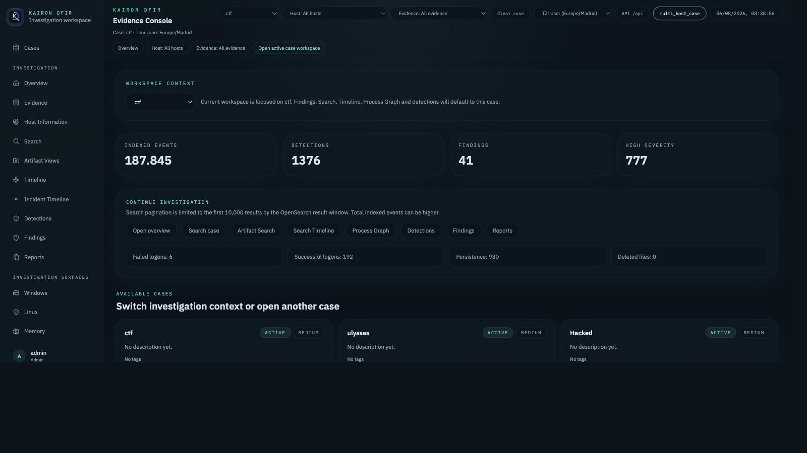
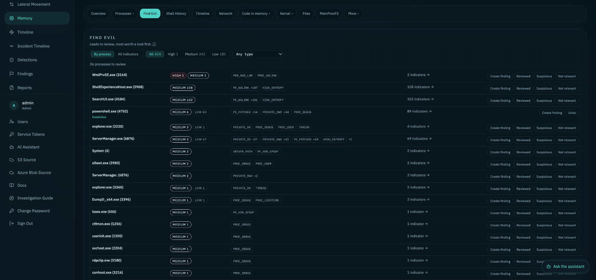
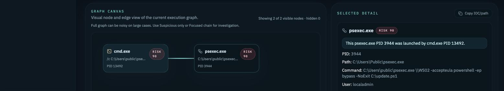
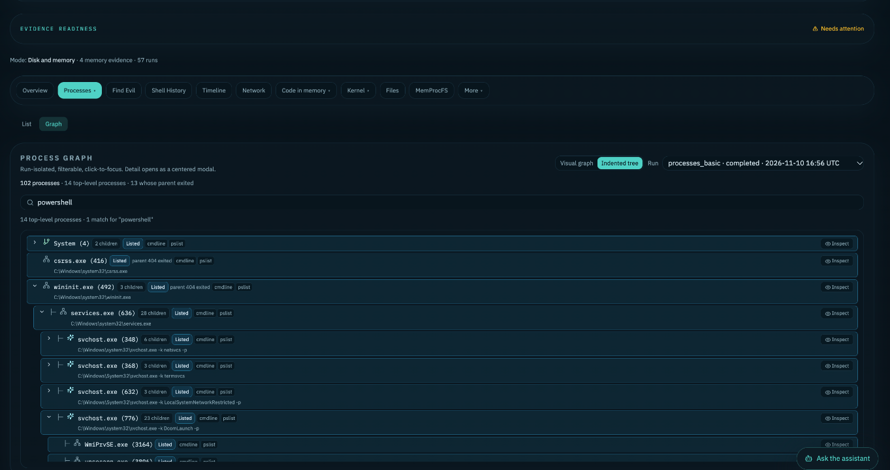
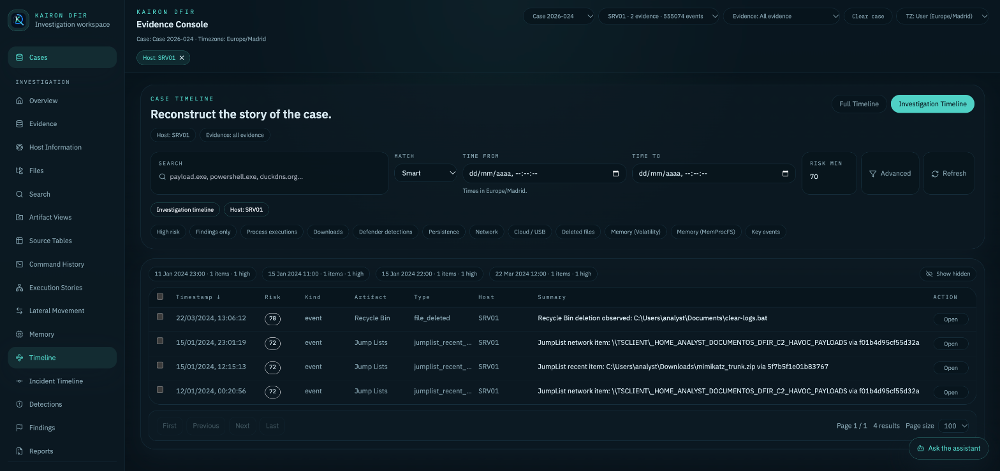

---
hide:
  - navigation
  - toc
---

Self-hosted DFIR platform

# Reconstruct the incident, from every artifact, in one place

Kairon DFIR ingests Windows, Linux, disk-image and memory evidence into a single case, normalizes it into one searchable model, and helps the analyst through Search, Timeline, detections, findings and reports — without replacing their judgment.

[Quick start](getting-started/quickstart.md){ .md-button .md-button--primary }
[User guide](getting-started/user_guide.md){ .md-button }
[GitHub](https://github.com/yokddj/kairon-dfir){ .md-button }

{ .kd-noshadow }

What it covers

<h2 class="kd-home-h2">From raw evidence to a reportable story</h2>

-   :material-tray-arrow-down:{ .lg .middle } __Guided evidence intake__

    ---

    Upload files or folders, disk images (RAW, EWF, VMDK, VHD/VHDX, QCOW2, VDI), Velociraptor collections, or import from S3 and Azure Blob. A preflight shows what will run before anything does.

    [:octicons-arrow-right-24: Evidence intake](evidence/unified-evidence-ingestion.md)

-   :material-microsoft-windows:{ .lg .middle } __Windows and Linux artifacts__

    ---

    EVTX, MFT/USN, Registry, Prefetch, LNK, Jump Lists, SRUM, Defender, browsers, USB and more on Windows; logs, journal, audit, web servers, containers and persistence on Linux.

    [:octicons-arrow-right-24: Parser coverage](artifacts/parser-coverage.md)

-   :material-memory:{ .lg .middle } __Memory analysis__

    ---

    MemProcFS and Volatility 3 for Windows and Linux images: processes, network, DLLs, handles, injected code, shell history, a process tree and Find Evil, all linked into the case Timeline.

    [:octicons-arrow-right-24: Memory Analysis](memory/memory_analysis.md)

-   :material-magnify:{ .lg .middle } __Search and timelines__

    ---

    Case-wide Search, a filterable Timeline, Command History, Execution Stories and a curated Incident Timeline that feeds the report.

    [:octicons-arrow-right-24: Search](search-and-investigation/search.md)

-   :material-shield-search:{ .lg .middle } __Detections and findings__

    ---

    Sigma and YARA on demand, built-in heuristics and correlations, and findings with severity, status and evidence links.

    [:octicons-arrow-right-24: Sigma and YARA](rules/rules_sigma_yara.md)

-   :material-server-security:{ .lg .middle } __Self-hosted by design__

    ---

    Runs on your own machine or lab with Docker. Evidence never leaves it, with SHA-256 integrity and custody events; the AI assistant and MCP server are optional and off by default.

    [:octicons-arrow-right-24: Deployment](deployment/deployment.md)

A look inside

<h2 class="kd-home-h2">Built for the questions an investigation asks</h2>

<figure markdown>

<figcaption>Find Evil ranks memory indicators by process and severity.</figcaption>
</figure>

<figure markdown>

<figcaption>Execution Story follows a suspicious chain to its command line.</figcaption>
</figure>

<figure markdown>

<figcaption>The process tree rebuilt from a memory image.</figcaption>
</figure>

<figure markdown>

<figcaption>The Timeline narrows a case to the events that matter.</figcaption>
</figure>

Documentation

<h2 class="kd-home-h2">Browse every guide</h2>

Capabilities are labeled `stable`, `partial`, `experimental`, `planned`, `unsupported` or `deprecated`; the [Parser Coverage Matrix](artifacts/parser-coverage.md) explains each status.

## Getting Started

- [Quickstart](getting-started/quickstart.md): quick start.
- [First-Run Setup](getting-started/first-run.md): first launch, admin creation, and troubleshooting.
- [Roles and Permissions](getting-started/roles-and-permissions.md): Administrator/Standard user roles.
- [User Guide](getting-started/user_guide.md): analyst flow from upload to report.
- [Windows & WSL2 Setup](getting-started/windows-wsl.md): installing on Windows via WSL2.
- [Evaluation Guide](getting-started/evaluation-guide.md): what to test and how to give feedback.
- [DFIR APP MVP Demo Guide](getting-started/demo_mvp.md): guided end-to-end walkthrough.

## Status and Maps

- [Roadmap](roadmap.md): roadmap by Core Platform / Core DFIR Capability classification — source of truth for maturity.
- [Project Status](project_status.md): project maturity summary.
- [Feature Map](feature_map.md): capability map, status, routes, backends, and limitations.
- [Known Limitations](KNOWN_LIMITATIONS.md): current known limitations.

## Architecture

- [Architecture](architecture/overview.md): general architecture overview and per-artifact-family decisions.
- [Platform Architecture](architecture/platform-architecture.md): multi-platform architecture, capabilities, artifact registry, and UI flow.
- [Information Architecture](architecture/information-architecture.md): capability registry and navigation.
- [Capability Registry](architecture/capability-registry.md): server-side capability registry and canonical routes.
- [RFC/ADR — Optional Capability Boundary](architecture/optional-capability-boundary.md): RFC/ADR — what it technically means for a capability to be optional in Kairon (Memory today, AI in the future).
- [Phase 2 Routing Audit](architecture/routing.md): canonical routes and legacy redirects reference.
- [Codebase Map](architecture/codebase-map.md): where each part lives in the code, how evidence flows through it, and where to start for common changes.

## Evidence

- [Unified Evidence Ingestion](evidence/unified-evidence-ingestion.md): guided 7-step wizard (includes Server Health Check) for adding evidence.
- [Importing evidence from S3](evidence/s3-import.md): importing one object from an S3 bucket (AWS or S3-compatible) as evidence; off by default.
- [Importing evidence from Azure Blob Storage](evidence/azure-blob-import.md): importing one blob from Azure Blob Storage (SAS, Entra ID service principal or account key) as evidence; off by default.
- [Preflight Inspection](evidence/preflight-inspection.md): read-only inspection before processing.
- [Disk Image Ingestion](evidence/disk-image-ingestion.md): read-only ingestion of RAW/EWF images, volumes, OS detection, and traceability.
- [Evidence Platform Selection](evidence/evidence-platforms.md)
- [Evidence Integrity & Chain of Custody](evidence/evidence-integrity.md): SHA-256 hashing and chain of custody.
- [Host Information](evidence/host-information.md): Host Facts and Local Accounts — coverage by platform, conflict resolution, and what is (and isn't) decoded from SAM/ProfileList on Windows.
- [Large Evidence](evidence/large_evidence.md): handling large evidence, mounted paths.
- [Evidence Processing Queue](evidence/processing-queue.md): per-case processing queue.
- [Evidence Ingestion](evidence/ingestion.md): ingestion pipeline.
- [Velociraptor Ingest](evidence/velociraptor_ingest.md): discovery and selective parsing of Velociraptor collections.

## Artifacts and Parsers

- [Parser Coverage Matrix](artifacts/parser-coverage.md): canonical matrix of parser status, formats, backends, and limitations.
- [EVTX / EvtxECmd](artifacts/evtx.md)
- [MFT / Filesystem](artifacts/filesystem_mft_usn.md)
- [Microsoft Defender Artifacts](artifacts/defender.md)
- [PowerShell artifacts outside EVTX](artifacts/powershell_artifacts.md)
- [Prefetch / PECmd / Native Prefetch](artifacts/prefetch.md)
- [LNK / LECmd / native_lnk](artifacts/lnk.md)
- [Jump Lists / JLECmd](artifacts/jumplists.md)
- [Registry / RECmd](artifacts/registry.md)
- [SRUM](artifacts/srum.md)
- [Shellbags](artifacts/shellbags.md)
- [Browser](artifacts/browser.md)
- [Scheduled Tasks / Task Scheduler](artifacts/scheduled_tasks.md)
- [Enriched USB](artifacts/usb.md)
- [Recycle Bin](artifacts/recycle_bin.md)
- [Autoruns / ASEP](artifacts/autoruns.md)
- [BITS](artifacts/bits.md)
- [Cloud Sync](artifacts/cloud_sync.md)
- [Network / WLAN / DNS](artifacts/network.md)
- [WMI](artifacts/wmi.md)
- [Execution Artifacts: Amcache, ShimCache, and AppCompat](artifacts/execution_artifacts.md)
- [Windows notifications (wpndatabase.db)](artifacts/windows_notifications.md)

## Linux

- Investigation Guide (in the app, under Docs; content in [data/investigation-guide.json](data/investigation-guide.json)): what to look for and where (execution, persistence, logons, lateral movement, Linux…), with searches that run on the active case.
- [Linux Support](linux/linux-support.md): full Linux support — collection formats, auto-discovery, every parsed family (logs, journal, web servers, databases, mail, VPN, containers, Kubernetes, persistence, configuration), Sigma on Linux logs, and limitations.

## Memory

- [Memory Analysis](memory/memory_analysis.md): status, plugins, and profiles of Memory Analysis.
- [Memory Operations](memory/memory_operations.md): enablement, optional worker, build, configuration, isolation, and troubleshooting.
- [Memory Upload](memory/memory_upload.md): dedicated memory image upload — flow, limits, streaming, and maintenance CLI.
- [Memory Process Model](memory/memory_process_model.md): canonical process entity/observation model.
- [Memory Process Graph & Indented Tree](memory/memory_process_graph.md): process graph UX.
- [Memory Runner Security](memory/memory_runner_security.md): threat model of the Memory runner.
- [Managed Windows symbols](memory/memory_symbols.md)
- [Memory Symbol Local-Operator Approval](memory/memory_symbol_operator_approval.md): operator approval flow for symbols.
- [Symbol Egress Gateway](memory/symbol_egress_gateway.md): symbol egress gateway architecture.
- [Symbol fetcher security](memory/symbol_fetcher_security.md): threat model of the symbol-fetcher.

## Search and Investigation

- [Search](search-and-investigation/search.md): Search workspace, filters, command-style phrases, and Timeline.
- [Search Timeline, Incident Timeline and Reports](search-and-investigation/timeline_reports.md): timeline and reports.
- [Source Tables](search-and-investigation/source-tables.md): CSV/TSV files as full-column, sortable tables.
- [Execution Story / Process Graph](search-and-investigation/process_graph.md)
- [Findings / Notes v1](search-and-investigation/findings-notes.md): investigative notes and findings.
- [Findings and Correlation](search-and-investigation/findings_correlation.md): taxonomy of auto-generated correlation findings.
- [Case Management](search-and-investigation/case-management.md): case status, priority, tags, archiving, and filters.
- [Application sections](search-and-investigation/app_sections.md): index of UI sections.
- [Semi-automatic analysis](search-and-investigation/semi_automatic_analysis.md): catalog of semi-automatic analysis sections.
- [Investigation workflow](search-and-investigation/investigation-workflow.md): scope/host-filtering mechanics across views.

## Rules

- [Rules, Sigma and YARA](rules/rules_sigma_yara.md): Sigma, YARA, and detections.
- [How to add new rules](rules/rule_authoring.md): how to write heuristic/Sigma/YARA rules.
- [Builtin rules](rules/builtin_rules.md): catalog of builtin detections.

## Deployment

- [Deployment Guide](deployment/deployment.md): canonical deployment guide — requirements, environment variables, volumes, operations, and security.
- [Deployment Modes](deployment/deployment-modes.md): localhost/lan/https modes.
- [Remote Deployment](deployment/deployment-remote.md): remote deployment runbook.
- [Backup and Restore](deployment/backup-restore.md)
- [Update and Rollback](deployment/update-rollback.md)
- [Beta Troubleshooting](deployment/troubleshooting.md): operational/infrastructure troubleshooting.

## Operations

- [Troubleshooting](operations/troubleshooting.md): application-level functional troubleshooting.
- [AI assistant](operations/ai-assistant.md): optional AI case assistant and provider configuration.
- [MCP server](operations/mcp-server.md): optional MCP server for external read-only case access.
- [Performance](operations/performance.md): performance profiles.
- [OpenSearch in Kairon DFIR](operations/opensearch.md): OpenSearch mapping and behavior.
- [API Summary](operations/api_summary.md): high-level endpoint map.
- [Testing](operations/testing.md): backend/frontend test suite.
- [MVP Demo Checklist](operations/demo_checklist.md): QA checklist for demos.

## Releases

- [Kairon DFIR 1.2.0](releases/1.2.0.md): release notes for 1.2.0.
- [Kairon DFIR 1.1.0](releases/1.1.0.md): release notes for 1.1.0.
- [Kairon DFIR 1.0.0](releases/1.0.0.md): release notes for 1.0.0.
- [Kairon DFIR 0.9.0-beta](releases/0.9.0-beta.md): release notes for 0.9.0-beta (historical).

## Community

- [../CONTRIBUTING.md](https://github.com/yokddj/kairon-dfir/blob/main/CONTRIBUTING.md): how to build, test, and propose changes.
- [../CODE_OF_CONDUCT.md](https://github.com/yokddj/kairon-dfir/blob/main/CODE_OF_CONDUCT.md): community standards.
- [../SECURITY.md](https://github.com/yokddj/kairon-dfir/blob/main/SECURITY.md): security policy, self-hosted deployment boundary, and vulnerability reporting.
- [../LICENSE](https://github.com/yokddj/kairon-dfir/blob/main/LICENSE) / [../NOTICE](https://github.com/yokddj/kairon-dfir/blob/main/NOTICE): AGPL-3.0 license and third-party notices.
